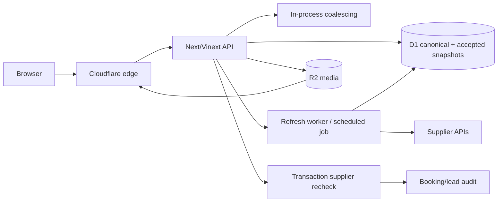

# VII API freshness and cache plan

Date: 2026-11-05
Scope: read-only audit of `.release-v790-candidate` at HEAD `72528243` plus the uncommitted taxonomy seed. This document is a target plan, not deployment evidence.

## Implementation checkpoint, 2026-11-05

Implemented in the cumulative candidate, pending exact public-release verification:

- Shared supplier taxonomy and amenity metadata snapshots: seven-day freshness, thirty-day hard expiry, provider/world/locale/source-generation/credential-scope isolation, single-flight refresh and durable D1 reuse.
- Accepted catalog membership is checked before reuse. Inactive source entries become empty tombstones. Explicit canonical feature arrays, including empty arrays, override historical backfills.
- Vacation offer snapshots: five-minute freshness and one-hour hard expiry. Current policy overrides previously persisted thirty-day expiry. Successful scoped empty responses replace older offers; malformed responses and provider failures do not.
- No public HTTP cache extends dynamic amenity or offer expiry. The application cache owns this policy. Transactional price and availability checks remain live.
- Administration overview does not initialize unrelated Biz snapshot schemas before rendering its lightweight V analytics.

Still targets: provider ETag/conditional support, scheduled incremental metadata refresh, dedicated class-partitioned retention metrics, and measured production percentile budgets. Existing bounded storage and cold source deadlines are retained. This checkpoint does not claim these targets are deployed.

## Recommendation

Use one typed freshness policy per data class in the existing modular application. Keep D1 as the accepted public snapshot store, memory/request coalescing as a short hot layer, and Cloudflare public caching only for immutable or explicitly stale-safe browse responses. Do not cache booking, quote, calendar, lead or permission decisions as authoritative results. Add versioned keys, stale-while-revalidate, provider failure cooldown, bounded leases and internal `checkedAt`/`stale` metadata to every browse class. The first causal fix is to stop amenities from making three supplier calls per request and create shared metadata snapshots. Reuse the existing cache primitive initially, but isolate long-lived metadata from high-cardinality offers before a full per-place rollout. Do not put an entire catalog or hundreds of place keys into the current 16-entry memory fallback and assume durable cache behavior.

This document was reviewed independently. The key isolation, conditional refresh, successful-empty/removal, UI-copy and transaction boundaries below incorporate that review. No cache deployment is claimed.

## Truth boundary

| Status | Finding |
|---|---|
| VERIFIED CURRENT | `app/lib/discovery-offer-cache.ts` has D1 plus process-memory fallback, 15-minute default fresh, 24-hour stale, 120-second failure cooldown, 60-second lease, 512-row admission bound and request coalescing. Individual callers override policy. |
| VERIFIED CURRENT | `app/lib/discovery-client-cache.ts` has browser memory/session reuse, default 2-minute fresh and 24-hour stale, one bounded GET retry, timeout default 5s and max 20s. It is discovery-only. |
| VERIFIED CURRENT | `/api/vii/home-deals`, `/api/spa/deals`, `/api/vii/home-holiday-deals` use discovery snapshots; public headers vary from 60s/5m to 5m/15m and stale-while-revalidate. |
| VERIFIED CURRENT | `/api/vii/business-amenities` advertises 5-minute browser freshness, 6-hour shared freshness and 24-hour stale, but `fetchLiveBusinessAmenities` uses `no-store` and calls detail plus `/types`, then sometimes the full vacations list. There is no shared metadata cache in that path. |
| VERIFIED CURRENT | `/api/vii/stay-calendar`, `/api/vii/stay-quote`, `/api/vii/stay-unit-quotes`, `/api/vii/booking` use `no-store` and supplier calls. This is correct for authority, but needs coalescing/rate protection without serving stale transaction truth. |
| VERIFIED CURRENT | `/api/vii/geography` reads D1 and exposes 120s public freshness, with a 30s empty fallback. `/api/vii/online-capabilities` uses a 5-minute public max-age, 30-minute shared fresh policy and 30-day maximum accepted age. |
| VERIFIED CURRENT | Existing code references D1 and R2 types and the project source of truth approves Cloudflare D1 as canonical and R2 as media store. No direct evidence here proves a deployed Cloudflare Cache Rule, Worker cache, R2 CDN policy, scheduled invocation, or measured hit ratio. |
| OPEN | Peak RPS, p95/p99 latency, provider quotas, Cloudflare zone cache rules, actual D1 row counts and cache hit/miss rates are not present in this audit. Do not select exact capacity or cost from assumptions. |

## Data-class policy

TTL values below are **TARGET recommendations**, not current behavior. `hard expiry` means the maximum age at which the product may use the value for browse; transaction classes are always hard-expired.

| Data type and owner | Key and payload bound | Fresh / stale / hard expiry | Invalidation or change trigger | Fetch and background rule | Dedupe, lease, failure policy | Privacy and response bound |
|---|---|---|---|---|---|---|
| Types, amenity taxonomy, accommodation types, feature labels. Supplier taxonomy plus VII normalized mapping | `taxonomy:{provider}:{contract}:{world}:{locale}:{schema}:{revision}`; normalized compact maps, target <=512KB | 7 days fresh; maximum total age 30 days in supplier outage | taxonomy version/hash, admin publish, supplier contract change or verified removal | Weekly conditional refresh when validators exist; source checksum comparison otherwise; warm before expiry, never per visitor | one durable lease per key; 10m cooldown; atomic complete replacement | public labels only, no supplier token, cap item/group counts |
| Geography, cities, regions and slugs. VII geography admin/D1 | `geography:v{schema}:{locale}`; target <=1MB | 1h / 24h / 7d | geography/admin save, slug/canonical change | D1 read on miss; async rebuild after mutation | request coalescing; 2m cooldown; never publish partial successful tree | public approved fields only; no private admin fields |
| Active inventory, identities and compact catalog summaries. D1 accepted generation | `catalog:{provider}:{contract}:{world}:{generation}:{locale}:{projection}`; detail separate; page <=2MB | Source check target 5-15m subject to provider quota; immutable accepted projection until generation superseded; last accepted browse fallback max24h | accepted generation, source version, activation/removal or moderation change | one bulk or paginated source sync; accepted snapshot read first; no detail API per card | generation lease; complete staged validation, checksum, atomic generation pointer; 2m cooldown | pagination or chunking preserves every ID, never silent truncation |
| Per-place general/unit amenity facts. Supplier plus accepted generation | `facts:{provider}:{contract}:{world}:{placeId}:{sourceRevision}:{taxonomyRevision}`; per-room IDs retained | 7d normal refresh; maximum total age30d during outage; immediate invalidation on verified change | source update event/version, admin refresh, explicit empty or removed feature | weekly off-request-path reconciliation, changed records first; no refetch on every search/detail/sliding card | per-place lease and bounded queue batches; cache only projected public facts | general and room provenance separate; preserve partial-accessibility qualifications |
| Detail content, reviews, room/unit facts and general/unit galleries. Supplier identity plus editorial layer | `detail:{world}:{supplierId}:v{sourceVersion}:{locale}`; target <=1MB per detail | 1h / 24h / 7d for content; media metadata 6h/7d/30d | supplier source version/checksum, editorial publish, media deletion/rights change | lazy detail fetch on place page; background warm only for requested/popular pages | per-place lease; 5m cooldown; stale content allowed, stale media must retain identity and mark unavailable | no raw private contacts or tokens; never substitute another unit gallery |
| Media binaries and transformed variants. R2/Images service | URL key by source checksum + transform width/format; per-object CDN key | immutable 1y+ / no stale distinction / until checksum deletion | checksum or rights/replacement event; purge old variants | Cloudflare Images/R2 edge delivery; lazy responsive sizes; no origin fetch on every card | object-level dedupe; bounded transform widths; no retry storm | rights metadata retained internally; public URL only; cap source dimensions and response bytes |
| Browse offers, sliders, dated availability snapshots. Supplier availability/price, D1 discovery cache | include provider, contract, world, dates, adults, children/ages if meaningful, rooms, slot, region, generation, currency and price basis | Target2-5m fresh; maximum total age15m for priced offers; imminent last-minute target60s fresh/max5m. All expire earlier at slot start, date rollover or14:00 cutoff when applicable | supplier snapshot version, date/cutoff rollover, capability/price-basis change | accepted snapshot first; refresh under one lease; cold miss bounded bulk load; no detail calls for each card |120s cooldown initially, tuned against hard expiry; no offer survives its semantic date boundary | no guest PII or precise user location in public keys; status metadata internal; quick-book promise requires valid priced offer |
| Date/party prices, calendars, stay quotes and unit quotes. Supplier authoritative transaction APIs | normalized key includes supplier id, from/till, guests, rooms, room IDs, provider contract version | 0 / 0 / immediate recheck; optional same-request coalescing only | every request or supplier version | synchronous supplier call with timeout; no stale fallback; quote reused only within one request | per-key in-flight dedupe <= request lifetime; no automatic retry for non-idempotent writes; circuit breaker | never persist guest data in shared cache; redact logs; strict input bounds |
| Final booking and lead/WhatsApp handoff. Supplier plus VII audit | idempotency key / receipt only; no response cache | 0 / 0 / 0 | provider acknowledgement/status reconciliation | durable intent/outbox then supplier call; status check for unknown | idempotency before call, bounded retry only when safe, manual queue for unknown | PII encrypted/minimal retention, no public cache, audit access controlled |
| Private admin reports, professor, analytics and conversion snapshots. D1/admin source | scope + period + basis + report schema version; payload target <=5MB, rows paged | 1-5m / 30d where semantically safe / period-dependent | source event arrival, report schema, manual refresh | overview reads lightweight complete inventory; detail/snapshots lazy; background report build | existing admin cache lease and cache version; failure snapshots cooldown; auth before DB | admin auth boundary, no browser/public cache, redact contact payloads |

## Current waste and priority defects

### Required semantics before the first cache rollout

- **No automatic factual reversal.** Missing source fields, an explicitly empty successful result, a404/410 deletion, malformed payload and a timeout are different states. Only verified successful changes/removals replace facts. A failed pull retains the last accepted version within its allowed age. A source contract that does not distinguish omission from empty must be versioned before using an empty array as a deletion signal.
- **Conditional weekly work.** Store ETag/Last-Modified only when the actual supplier supplies them, then send conditional requests and accept304 without rebuilding. Where unsupported, use documented incremental updates if available. Otherwise perform one bounded weekly full pull, compare normalized content hashes and rebuild only changed records. Do not claim supplier validators or webhooks exist before observing them.
- **Removal and rollback.** A verified deletion writes a tombstone, invalidates place facts/search/catalog/detail/page variants, and cancels queued older refreshes. Newer source versions win. A rollback of application code must not revive removed source records. Administrative refresh invalidates only its provider/world/place family.
- **Layered expiry.** Inner data expiry is authoritative. Browser/CDN/stale windows cannot add up to extend a fact past its hard expiry. Emit age-aware remaining TTL. A build, taxonomy or accepted-generation change moves to a new key namespace and must not mix old HTML with new assets.
- **No technical public copy.** Cache age, TTL, provenance and diagnostics belong in internal metadata, headers and administration. Do not add the rejected freshness/disclaimer sentence to sliders. Expired offers cannot retain a quick-book promise merely because the final booking also rechecks.
- **No partial publication.** Pagination must complete, IDs must reconcile and unexpected removals must be reviewed before an accepted-generation pointer moves. A source timeout or a truncated page is not a successful empty catalog.
- **No public private-data cache.** Authentication and permissions execute before private reads. No shared response cache for account/admin, cookies, authorization, quotes, lead payloads, WhatsApp forms or booking. For nearby public results, quantize location for shared discovery or keep exact coordinates request-private. Never put names, phones or exact location in logs/cache keys.
- **Deadline and concurrency budgets.** Metadata: at most one refresh per scope,8s source deadline, no immediate retry after a timeout;10m cooldown target. Catalog jobs: bounded chunks and concurrency2 initially; queue continuation instead of one massive request. Interactive offers: one bulk request per identical key, bounded timeout, no N+1 detail calls. Final transaction: bounded provider deadline plus explicit unknown-state reconciliation, never retry an uncertain write.
- **Clock authority.** Store UTC milliseconds from the server, never visitor time. Calculate calendar dates and the14:00 last-minute boundary explicitly in `Asia/Jerusalem`, including daylight-saving transitions. Reject future `checkedAt` values beyond the allowed skew, and treat a source version as stronger than source timestamps. Do not extend TTL when the clock moves backwards. Test13:59:59,14:00:00, midnight and both DST transitions using an injected clock.
- **Lease recovery and fencing.** A refresh owns a bounded lease and unique fencing token tied to the accepted source/taxonomy generation. Commit only if both still match. A crashed worker loses authority on expiry; a late completion cannot overwrite a newer generation or a tombstone. Lease duration must exceed the refresh deadline by a measured safety margin. Existing60s leases are an implementation reference, not an unlimited job lock.
- **Atomic visibility.** Stage catalog/facts/detail/search/gallery projections under the new generation, validate them, then swap one accepted-generation pointer. All reads pin that generation for the request. Removal tombstones are checked before any older cache fallback; revoke old immutable media URLs when necessary, then purge affected public variants. CDN purge is propagation, not the source of truth for removal. Partial refreshes never move the pointer.
- **One background refresh, bounded stale response.** A request with usable stale data returns once while one lease holder refreshes. Followers do not poll or launch another refresh. Browser requests do not repeat retries while the same refresh is pending. An accepted hard expiry blocks expired price/availability promises even if the refresh has not finished.
- **Privacy-safe observations.** Metric labels use data class, world, outcome and coarse latency buckets. Keep no supplier IDs, precise locations, dates/party combinations, tokens or hashed raw request keys as metric labels. Traces retain only a random operation ID plus the minimum access-controlled diagnostics; define retention before enabling detailed logging.
- **Taxonomy rollback.** Maintain source revision and removal watermarks independently of application build. Reverting a build may revert presentation logic, but cannot lower the accepted taxonomy revision, erase tombstones or republish a superseded inventory. A compatibility check blocks an old reader which cannot understand the current schema; forward-fix instead of silently downgrading facts.

These requirements are acceptance gates, not claims that the existing implementation already satisfies them.

1. `app/lib/live-business-amenities.ts` performs two parallel supplier calls on every uncached request and a third full-list call when detail has no usable groups. The API route's public cache headers do not prevent origin work when the route is bypassed or its implementation is called directly. Build a shared `taxonomy` snapshot and cache the per-place normalized amenity result separately. Do not mix room amenities into place amenities.
2. `/api/vii/home-deals` and `/api/vii/live-search` correctly avoid provider fan-out for accepted discovery paths, but their cache keys must remain tied to date, guests, rooms/slot, region and contract version. Any change to selection or normalization must bump the key version and compare supplier IDs, not just counts.
3. `discovery-offer-cache.ts` is a useful primitive, not proof of a global cache. Its 512-row bound and 1MB payload bound are safe guards, but high-cardinality dated/party keys can evict long-lived snapshots. Add class-specific admission/retention metrics before changing the limit.
4. `discovery-client-cache.ts` is browser/session reuse only. It does not replace D1 freshness or provider authority and should not be used for calendar, quote or booking.
5. Media route comments indicate R2 allowlisting, but this audit does not establish an active CDN/image transformation policy. Verify cache headers, source checksums, responsive width negotiation and purge behavior separately.

## Target flow

This is a **TARGET** diagram. It does not prove a worker, scheduled job or edge cache is deployed.

## Implementation sequence

Named responsibility: root owns implementation and cumulative source integrity; supplier-contract specialist owns source/ID parity; independent checker attacks key isolation, removals, expiry and final destination. No new infrastructure purchase is part of this plan. Add queues or a dedicated metadata table only after the current cache admission and job-duration evidence establishes the need.

### Phase 1, metadata and measurement

- Add a typed `FreshnessPolicy` registry with class, key version, fresh/stale/hard ages, payload cap, owner and privacy class.
- Instrument cache hit, stale serve, refresh, cooldown, lease contention, provider latency and payload bytes. Use privacy-safe keys and never log tokens, guest data or raw contact payloads.
- Implement taxonomy and geography snapshots first. Ensure taxonomy changes invalidate normalized amenity projections without touching every place page synchronously.
- Add a single-flight loader for `types` and place amenity projections. Keep the current legacy fallback only behind an explicit degraded state.
- Before adding hundreds of fact entries, give metadata its own retention/admission budget so dated offers cannot evict it; run the migration only with a tested rollback. One7-day policy in the existing512-row cache is not by itself a complete storage design.

### Phase 2, discovery and media

- Make offer cache policies explicit per world/date class, preserving accepted D1 snapshots and supplier-ID completeness.
- Add generation/source-version fields to catalog and gallery cache keys. Rebuild search/page/media projections asynchronously after accepted-generation changes.
- Verify R2/Images headers and checksum-based immutable URLs. Add bounded responsive variants and purge tests.

### Phase 3, transaction protection and operations

- Add per-supplier timeouts, circuit breakers and request coalescing for identical read-only calendar/quote calls, with no stale transaction response.
- Preserve booking idempotency and unknown-status reconciliation. Add dashboards and alerts for provider failure, cache staleness, lease contention and zero-result regressions.
- Run restore/reconciliation and provider-outage drills before changing hard expiry or increasing cache bounds.

### Phase4, experience and measured release

- Public HTML renders the lightweight usable shell and accepted first-page results without waiting for map code, all galleries, all reviews or administration modules.
- Search performs cheap semantic filtering on a complete compact indexed projection; result pages use stable pagination. Map reads only compact coordinates/price/status for the relevant viewport and renders clusters progressively. Zoom never substitutes city-center coordinates for a known property coordinate.
- Prefetch likely same-site navigation at idle or user intent with a byte/concurrency budget. Cancel obsolete requests, isolate critical bundles and deduplicate route/data requests. Do not prefetch every gallery or every world.
- Administration first loads totals and one paged topic. Business performance breakdowns and period comparisons load on explicit expansion or background summary refresh, preserving complete totals and access scope.
- Release on one immutable source/build identity with a known rollback. Warm only safe public keys, then verify actual URLs on desktop/mobile and cold/warm navigation. Do not enable an edge rule whose expected build is the old release.

## Measurement and release targets

All numbers here are **TARGET**, not measured current performance. Measure Israel desktop and mid-range mobile separately under a documented network profile. Keep cold-cache, warm-cache and supplier-outage samples separate.

| Signal | Acceptance target and evidence |
|---|---|
| Metadata traffic | Repeated500 reads of the same fresh scope cause zero supplier refreshes; simultaneous cold reads cause one refresh, including across worker isolates when using durable leases. |
| Initial loading | First usable content target<=1.5s warm; Core Web Vitals initial gate LCP p75<=2.5s, INP p75<=200ms, CLS p75<=0.1; target further improvements after real measurements. |
| Navigation | Warm same-site route content target<=500ms p95; no blank entire-page loader during background metadata refresh. |
| Map interaction | Drag/zoom visual response target<=100ms; no repetitive full-catalog render; profile long main-thread tasks and result/marker sync. |
| Cache | Hit/stale/miss, origin call count, lease contention, payload size, evictions, age and refresh failure measured per class and world; no fabricated overall hit-ratio claim. |
| Data integrity | Compare exact business/unit IDs, feature IDs and qualifications, gallery order, price basis, party/date state, approved SEO/301 intents before and after; equal counts alone are insufficient. |
| Outage | No erased catalog on timeout, no cross-world facts, no expired availability/price promise and no stale final booking acceptance. |

## Current source implementation status

The source candidate now contains a bounded approximately50KB legacy amenity-search index and shared backfill for old vacation rows that omit `searchFilterIds`. It also preserves typed upstream numeric amenity identities and honors explicit new arrays, including empty arrays. This addresses a measured source-to-search parity defect and does not implement the cache rollout above. The metadata snapshot cache, conditional supplier refresh, durable scheduler, class admission separation and production performance targets remain TARGET until implemented and observed. Neither this document nor a local build proves a public release.

## Official infrastructure references checked2026-11-05

- Cloudflare cache-control semantics: https://developers.cloudflare.com/cache/concepts/cache-control/
- Invalidation versus hard removal: https://developers.cloudflare.com/cache/guides/invalidate-cache/
- Workers execution and subrequest limits: https://developers.cloudflare.com/workers/platform/limits/
- Queue limits and bounded continuation: https://developers.cloudflare.com/queues/platform/limits/

These references justify checking actual plan/binding limits before selecting job size or capacity. They do not prove that a queue, schedule, cache rule or paid feature exists in this account.

## Acceptance gates

1. A cold place page makes at most one taxonomy fetch per freshness window and one place-detail fetch; the full vacations list is not fetched for every request.
2. A taxonomy update is visible after invalidation and never requires a deploy; a provider outage serves a bounded, labeled stale taxonomy or an explicit unavailable state.
3. Dated browse results preserve complete supplier identity sets, expose `checkedAt` and never use a stale browse snapshot as final booking authority.
4. Calendar, quote, unit quote and booking requests never read a shared stale cache; duplicate in-flight reads are bounded and writes remain idempotent.
5. Media tests prove general and unit gallery identity, checksum-based variant URLs, no cross-unit fallback, and correct cache/purge behavior.
6. Cache payload and row admission limits are enforced with metrics, and large catalogs do not silently truncate inventory.
7. Admin endpoints remain authenticated, report overview is lightweight, detail snapshots are lazy, and no contact payload is sent to a public/browser cache.
8. A Cloudflare production check records exact zone/cache rules, D1 binding, R2 binding, worker/scheduler identity and deployment revision. Until that evidence exists, these remain TARGET.

## Explicit non-goals and blockers

- No Cloudflare account, zone, Worker, R2, D1, environment, schema or secret was changed by this audit.
- No current provider quota, measured traffic, hit ratio, scheduler execution or backup/restore evidence was available here. Exact TTL/cost/SLO claims remain OPEN until measured.
- AWS is not a target route. The project source of truth explicitly keeps VII on Cloudflare and treats historical AWS configuration as non-authoritative.
