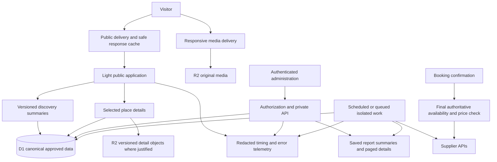

# תכנית ביצועים ל־VII

תאריך: 4 בנובמבר 2026. המסמך מציג מחקר ותכנית ביצוע. הוא אינו אישור השקה ואינו טענה שכל השינויים כבר פורסמו.

## ההמלצה

להישאר ב־Cloudflare, בהתאם להחלטה המאושרת, ולהוציא מהמסלול של הגולש עבודה שאפשר להכין מראש. העמוד צריך לקבל תוכן שימושי במהירות, ואז להוסיף מידע לפי הצורך. בדיקת הזמנה ממשיכה לפנות למקור הסמכות בזמן הנכון. כל הרשומות, התמונות, יחידות האירוח, הטקסטים והעמודים נשמרים.

העדיפות היא קודם לקצר את זמן תחילת התשובה ולסלק כשלים בזיכרון, במקביל להקטנת העומס על הדפדפן. הגדלת תקציב לבדה אינה הוכחה לפתרון. לכל רכיב חדש תהיה סיבה מדידה, בעל אחריות, בדיקה ודרך חזרה.

## מה נבדק ומה עוד לא הוכח

הבדיקה שילבה קריאת קוד, מסך ניהול מאומת, ראיות מפרסומים קודמים, בקשות ציבוריות סדרתיות ותיעוד ספק רשמי. לא בוצעה בדיקת עומס על הייצור.

| ממצא | ראיה | משמעות ומגבלה |
| --- | --- | --- |
| מסך ביצועי העסקים מציג 921 שורות בפתיחה וכ־23,727 צומתי DOM | בדיקה בדפדפן מחובר; כל 921 מזהי העסקים ייחודיים | עומס מוכח על מסך אחד. אין להסיק שזהו מספר הצמתים בכל האתר |
| זמן תחילת תשובת HTML ארוך גם בדפים ציבוריים | שמונה בקשות אנונימיות עם כותרת HTML, בשני סבבים, ב־12:44 עד 12:45 UTC | מדובר במדגם קטן מתחנת הבדיקה דרך FRA. זה אינו מדד שטח של גולשים בישראל ואינו אחוזון |
| מטמון ציבורי קיים ופועל | הסבב הראשון הראה MISS והסבב השני HIT בשכבת R2 | אין בסיס לומר שאין CDN או מטמון. עדיין צריך להסביר את ההמתנה גם כשיש HIT |
| כשלי זיכרון תועדו בפרסום קודם | ראיות v795 ופתוח במפורש בראיות v796 | סיבת ההקצאה לא הוכחה בפרופיל זיכרון. אין לייחס אוטומטית כל תקלה חדשה לאותה סיבה |
| קובץ פרטי ספק בגודל 7,463,560 בתים מיובא בתחילת מודול קטלוג משותף | קוד מקומי וקובץ הנתונים | חשד מבוסס לעומס אתחול וזיכרון. גודל JSON אינו שווה לצריכת הזיכרון בפועל |
| תוצר השרת המקומי בגודל 19,295,290 בתים לפני דחיסה | תוצר הבנייה הקיים | אין להסיק חריגה ממגבלת העלאה דחוסה. צריך לנתח עץ תלויות וזמן אתחול |
| חימום קישורים עשוי להפעיל גם בקשת ניווט וגם בקשת מסמך | רכיב החימום בקוד | ההתנהגות בקוד מוכחת; היקף הבקשות המיותרות אצל לקוחות עדיין דורש trace |
| ההפעלה המתוזמנת של מחממי הנתונים עדיין לא אומתה | מקור cron וראיות השחרור הקודם | רענון רקע בעקבות ביקור כן תועד. עצם הגדרת cron אינה הוכחת הרצה |

הקבצים שנבדקו כוללים:

```text
app/admin/business-performance/page.tsx
app/api/admin/business-performance/route.ts
app/lib/public-catalog-read.ts
app/components/smart-navigation-warmup.tsx
worker/index.ts
worker/public-response-cache.ts
worker/responsive-image-transform.ts
vite.config.ts
project_knowledge/release_evidence/v796-event-discovery.json
```

מדידת HTML עם כותרת בקשה מתאימה לדפדפן:

| מסלול | סבב ראשון: תחילת תשובה | סבב שני: תחילת תשובה | מצב מטמון בסבב השני |
| --- | ---: | ---: | --- |
| `/` | 3.41 שניות | 2.44 שניות | HIT, R2 |
| `/search` | 6.90 שניות | 2.47 שניות | HIT, R2 |
| `/events` | 5.07 שניות | 2.47 שניות | HIT, R2 |
| `/business?id=vacation-164` | 3.67 שניות | 4.03 שניות | HIT, R2 |

כל שמונה הבקשות החזירו 200. זמני קריאת המטמון שדווחו בכותרות היו 544 עד 694 אלפיות שנייה. הבדיקה הראשונית ללא כותרת HTML עקפה את מדיניות המטמון, ולכן אינה משמשת כאן כמדידת HIT. בשתי בקשות אבחון נוספות חיבור TLS הסתיים לאחר כ־0.18 שנייה; תחילת התשובה הגיעה לאחר 0.89 שנייה בבית ו־2.80 שניות בחיפוש. אין לייחס את כל ההפרש לשאילתות מסד בלי מדידה מפורטת של הנתיב.

## יעדי קבלה

אלה יעדים מוצעים, לא תוצאות שכבר הושגו. תחילה מקימים מדידת בסיס באותה מתודולוגיה, ואז משווים.

| תחום | יעד |
| --- | --- |
| תחילת תשובה ציבורית ממטמון חם | עד 500 אלפיות שנייה באחוזון 95 במדידה מישראל, לכל משפחת מסלולים שמוגדרת כשירה למטמון |
| תחילת תשובה ללא מטמון, ללא קריאת ספק | עד 1.2 שניות באחוזון 95 תחת העומס המייצג שיימדד |
| תוכן ראשי במכשיר נייד | LCP עד 2.5 שניות באחוזון 75 של נתוני שטח |
| תגובה לאינטראקציה | INP עד 200 אלפיות שנייה באחוזון 75 |
| יציבות חזותית | CLS עד 0.1 באחוזון 75 |
| מעבר שהוכן מראש ומידע תצוגתי מקומי | יעד עד 300 אלפיות שנייה להצגת התוכן השימושי; מדידת מעבר נפרדת מטעינת מסמך חדש |
| מסך ביצועי העסקים | פחות מ־3,000 צומתי DOM בפתיחת הסקירה; עד 50 שורות בטבלה פעילה; חיפוש ומיון על כל הרשומות |
| שלמות | אין אובדן עסק, יחידה, גלריה, תוכן, שדה או מדד מול אותו דור נתונים מאושר |
| אמינות | אפס כשלי זיכרון ואפס 5xx במסלולים הקריטיים בחלון בדיקה מוגדר; יעדי שירות מתמשכים ייקבעו אחרי בסיס תעבורה אמיתי |

יעדי חוויית המשתמש מבוססים על ההגדרות של Google. תוצאת מעבדה טובה אינה מחליפה נתוני שטח. [מקור](https://web.dev/articles/vitals)

## שלבי העבודה

הזמנים הם אומדן עבודה לצוות מצומצם: אחראי יישום אחד, מומחה תשתית למשימות מובחנות ובודק עצמאי לשחרור. השלבים יכולים לחפוף רק כאשר אינם משנים את אותם רכיבים. ההערכות תלויות בגישה לנתוני הייצור ובתוצאות האבחון, ואינן התחייבות לשעת סיום.

| שלב | עבודה ותוצאה | משך משוער | אחראי ושער יציאה |
| --- | --- | --- | --- |
| 0 | לקבע גרסה, מפת מסלולים, מדידת בסיס ופירוק זמן בקשה | חצי יום עד יום | אחראי יישום ומומחה תשתית; אפשר להסביר היכן נצרך הזמן בכל מסלול מייצג |
| 1 | לצמצם עבודה בפתיחה, להשלים תיקון דוח העסקים, לבטל בקשות שהתיישנו ולתחום מקביליות | יום עד יומיים | אחראי יישום; נתונים מלאים ובדיקה שהדפדפן אינו בונה מאות שורות מיותרות |
| 2 | להקל את אתחול השרת ולהוכיח מטמון יעיל למסמך ולניווט | יומיים עד ארבעה | מומחה תשתית עם אחראי יישום; פרופיל זיכרון, השוואת HIT/MISS וקיצור זמן מוכח |
| 3 | תקצירי חיפוש ושאילתות ממוקדות, סנכרון ורענון רקע אמינים | יומיים עד ארבעה | מומחה נתונים; התאמת מזהים ושדות לספק, בלי חיתוך מלאי ובלי ספק בנתיב הרינדור |
| 4 | תמונות, JavaScript, מפות ומעברי עמודים | יומיים עד ארבעה, חלקם במקביל | אחראי ממשק; בדיקות מכשיר נייד, איכות תמונה ותסריטי מפה |
| 5 | עומס מדורג בסביבת בדיקה, בדיקת שחרור וניטור אחרי פרסום | יום עד יומיים ועוד 48 עד 72 שעות תצפית | בודק עצמאי; שיפור מדוד ללא נסיגה בשלמות או בתהליכים עסקיים |

טווח סביר לגרסה ראשונה משופרת: יום עד שלושה ימי עבודה אחרי מדידת הבסיס. טווח לפרויקט היסודי: כשבועיים עד שלושה, בכפוף לממצאים. מפרסמים שיפורים נפרדים שעברו את השערים, ולא מחכים לסוף הפרויקט כדי להשיג שיפור ראשון.

### שלב 0: לדעת מה מעכב כל מעבר

למדוד את ארבעת העולמות, דף הבית, עמודי אזור וסינון, עמוד מתחם ויחידה, הזמנה, מפה ומשפחות מסכי הניהול. בכל משפחה: ביקור ראשון, ביקור חוזר, מעבר פנימי, רענון, אחורה וקדימה; נייד ומחשב; אנונימי ומחובר כאשר רלוונטי.

להוסיף מזהה בקשה וגרסה, ותזמוני שרת שאינם כוללים מידע אישי: בדיקת הרשאות, קריאת מטמון, מסד, ספק, רינדור ותחילת stream. להפריד זמן CPU מזמן המתנה. למדוד גם זמני JavaScript, משימות ארוכות, גודל תוכן ומדדי משתמש אמיתי. דוח המדידה מפולח לפי מסלול, מכשיר, מצב מטמון וגרסה.

לבדוק את הנתיב דרך שירות הפרסום עצמו מול זמן היישום. HIT איטי עשוי לכלול אחסון, אתחול, שכבת אירוח ורשת. בלי הפירוק הזה לא מחליטים להעביר את הדומיין או להחליף סביבת ריצה.

### שלב 1: להפסיק לטעון הכול בפתיחה

בדוח העסקים: סקירה, רשימת עסקים, מכירות, פניות והיסטוריה נפתחים בנפרד. מידע שמור ממערכת המכירות נטען רק כשמבקשים אותו. פרטי פניות נטענים רק אחרי בחירה מפורשת. 50 שורות בכל עמוד הן מגבלת תצוגה בלבד; הסכומים, הסינון, המיון והייצוא נשארים מלאים.

היישום המקומי כבר כולל הפרדה זו ובדיקות של הרכיב ושל נתיבי השרת. הוא עדיין דורש בנייה, בדיקות המשפחה ובדיקה בדפדפן של גרסת היעד. אין להציג אותו כשינוי ציבורי מאושר.

גם בשאר הממשק: רכיבי מפה, לוחות שנה, גרפים ופרטי גלריה נטענים לפי הצורך. תוכן מרכזי ותוכן SEO נשארים זמינים במסמך. בקשה ישנה לא יכולה לדרוס בחירת אזור, תאריך או עסק חדשה. אין לבצע קריאות חוזרות אוטומטיות ללא תקציב ניסיונות ומצב כשל ברור.

### שלב 2: שרת קל ומטמון שמועיל בפועל

לנתח את עץ התלויות של תוצר השרת. להוציא פרטי קטלוג גדולים, עבודות סנכרון ודוחות שאינם נחוצים לכל בקשה מטעינה גלובלית. נתוני פירוט ייקראו לפי מזהה מתוך D1 או אובייקט R2 בגרסה מוגדרת; רק תקציר קטן ונדרש נמצא בנתיב הראשוני.

לשמר snapshot מאושר למקרי כשל בלי לארוז בכל בקשה את כל פרטי העסקים. מעבר למקור החדש יתבצע באמצעות קריאה מקבילה מוגבלת בסביבת בדיקה, השוואת מזהים ושדות, ואז החלפה נשלטת. דור נתונים חלקי לא הופך לדור פעיל.

Cloudflare מפרסמת מגבלת זיכרון של 128MB לכל isolate גם במסלול בתשלום. העלאת מכסת CPU אינה הגדלת זיכרון. צריך למדוד ולהקטין את העבודה המשותפת. [מקור](https://developers.cloudflare.com/workers/platform/limits/)

למטמון יוגדר בעל אחריות לכל משפחת נתונים: מפתח, גרסה, תפוגה, invalidation, מדיניות מידע שהתיישן ומקור חלופי. יש מטמון קיים, ולכן מתחילים במדידת היעילות וההתנהגות שלו ולא מוסיפים שכבה כפולה ללא צורך.

לבדוק בנפרד מסמך HTML ונתוני ניווט RSC: אין להחליף ביניהם, ואין להחזיר HTML של גרסה עם קבצי JavaScript מגרסה אחרת. שפה, כתובת קנונית, פרמטרים מותרים וזהות דור נתונים משתתפים במדיניות. לא מסירים headers או cookies באופן גורף כדי לכפות HIT.

תוכן אישי, ניהול, הרשאות, פניות והזמנות לא נכנסים למטמון ציבורי. קריאת זמינות לצורך גילוי יכולה להשתמש בנתון שמור עם גיל גלוי וגבול תפוגה; אישור הזמנה מחייב בדיקה מוסמכת מחדש. שינוי CMS או דור ספק מאושר חייב לבטל או להחליף את המפתח המתאים.

אם הפרדת עבודות הכבדות תביא תועלת מדידה, להפעיל Worker נפרד לסנכרון ודוחות באמצעות Service Bindings ותור. הפרדת שמות שירות בלבד אינה מועילה אם כל השירותים ממשיכים לייבא את אותו גרף נתונים גדול. יכולת החיבור בסביבת הפרסום המדויקת עדיין טעונה אימות. [מקור](https://developers.cloudflare.com/workers/runtime-apis/bindings/service-bindings/)

### שלב 3: חיפוש ונתוני ספק בלי להמתין לספק בכל דף

הקטלוג המאושר הוא מקור גילוי מקומי, עם מזהה ספק, עולם, דור, זמן בדיקה וסטטוס פרסום. ליצור תקצירים ממוקדים לחיפוש ולכרטיס, ולהביא פירוט מלא לעסק שנבחר. מאפיינים, סוגים ראשיים ומשניים, יחידות ומדיה נשמרים בשדות הנכונים.

שאילתות ייבדקו באמצעות EXPLAIN ומספר שורות שנקראו. מוסיפים אינדקסים לפי תנאי WHERE ומיון שנמדדו. דוחות ארוכים עוברים לאגרגציה תקופתית, עם אפשרות reconciliation מול הרשומות המקוריות. אין LIMIT שרירותי שמעלים מדדים או עסקים. [מקור](https://developers.cloudflare.com/d1/best-practices/use-indexes/)

רענון מלאי וסליידרים מתבצע ברקע עם נעילה משותפת, זמן קצוב, ניסיונות מוגבלים ורישום הצלחה וכשל. אותו מפתח תאריך והרכב יקבל רענון אחד משותף. יש לאמת הפעלה מתוזמנת אמיתית באמצעות חותמת זמן ותוצאת שמירה. חלון 14:00 לפי ישראל, סוף שבוע, חגים ושעון קיץ הם בדיקות חובה.

המידע האחרון המאושר נשמר רק בגבול הגיל המותר ובאותו scope. כשל אינו הופך את הסליידר לריק ואינו מוצג כ״אין זמינות״. כאשר לא ניתן לאמת, מציגים מצב אמיתי וקישור מתאים בלי להבטיח מחיר או הזמנה שאינם מאומתים.

מנוע חיפוש נוסף אינו תנאי פתיחה. יש להוסיף אותו רק אם D1 עם מודל תקצירים ושאילתות נכון אינו עומד ביעד המדוד. אינדקס חיפוש הוא נגזרת הניתנת לבנייה מחדש, לא מקור האמת.

### שלב 4: תמונות חדות וממשק קל

לשמור את קובץ המקור הטוב ביותר ולהגיש גרסאות בגודל המתאים לשטח התצוגה ולצפיפות המסך. לבחור רוחבים מוגדרים מראש, פורמט מתאים ואיכות לאחר בדיקה חזותית. הגדלה מלאכותית אינה משחזרת פרט שלא קיים במקור.

יש קוד לחיבור Images ונתיב שינוי גודל. צריך להוכיח בייצור את המנוע, המידות, סוג הקובץ והמשקל שמתקבלים בפועל, כולל כשל והשבת מקור תקין. אין להסתפק בכך שהתמונה נטענת. עיבוד פיקסלים גדול לא יבוצע בזיכרון של Worker האפליקציה. [מקור](https://developers.cloudflare.com/images/optimization/binding/)

תמונת התוכן הראשי מקבלת קדימות; שאר התמונות נטענות סמוך להופעתן. גלריה אינה מורידה את כל תמונות המקור מראש. לכל תמונה ממדים יציבים, מטמון עם זהות מקור ויחידה נכונה, ותיקון מקור שבור שאינו שואל תמונה מעסק או מיחידה אחרים.

בניווט: לשמור את מעטפת העמוד, לחלק JavaScript לפי מסלול, ולהכין רק יעדים סבירים לפי כוונת משתמש. להגביל חימום מקבילי ולבטל בקשות מיותרות. לבדוק אם נדרשות גם בקשת RSC וגם HTML לאותו יעד. יש לשמור את מדיניות פתיחת העמודים המאושרת ולהוכיח אחורה/קדימה ושימור חיפוש.

במפות: טעינה מאוחרת, קיבוץ סמנים, רשימה מוגבלת לתצוגה, סנכרון בחירה בין כרטיס לסמן, ורענון לאחר עצירת תנועת המפה. אין לבנות מחדש את כל הכרטיסים והסמנים בכל אירוע תזוזה. טעינת עוד תוצאות משמרת ספירה מלאה ומידע קיים. נדרשת בדיקה גם בנייד ובמעבר תצוגה.

פונטים בעברית יישארו במשפחה המאושרת, עם fallback מודרני וללא הבהוב של גופן שגוי. הפחתת משקל אינה הרשאה לפגוע ב־RTL, בכפתורים, במקלדת או בקורא מסך.

## מבנה היעד

זהו תכנון, לא תרשים של חיבורים שכבר הוכחו בייצור.



## שמירת המוצר והמידע

| משפחה | מה חייב להישמר | הוכחת קבלה |
| --- | --- | --- |
| קטלוג וחיפוש | כל המזהים המאושרים, סוגים משניים, מאפיינים, נגישות וסדר מחירים אמיתי | השוואת קבוצות מזהים ושדות על אותו דור; חיפוש גם לעסק שמחוץ לעמוד הראשון |
| זמינות והזמנה | הבחנה בין פנוי, לא פנוי, לא ידוע, מחיר והזמנה נתמכת | התאמה לספק בתאריכים והרכבים מוגדרים; בדיקה חוזרת באישור הזמנה |
| סליידרים | כל המלאי הרלוונטי, עמודים ייחודיים, תאריך נכון ומעבר 14:00 | בדיקת מקור, snapshot, API וכרטיסים; התוצאה אינה נחתכת למגבלת עיצוב |
| גלריות | שיוך עסק ויחידה, סדר, ספירה ואיכות מקור | השוואת media IDs ופתיחה בפועל, כולל תמונות שאחרי העמוד הראשון |
| SEO ותוכן | עמודים מאושרים, 301, canonical, שפות, מטה, FAQ ומפת אתר | בדיקות מסמך מלא וניווט; תוכן קריטי אינו נעלם מאחורי טעינה שמחייבת אינטראקציה |
| דוחות | כל הרשומות, אותם סכומים, תקופה, מקור והגדרת כל מדד | השוואת אגרגציה ומקור; ייצוא כל התוצאות המסוננות, לא רק העמוד הנראה |
| ניהול ופרטיות | הרשאות, שמירה, רענון, audit והפרדת משתמשים | בדיקת משתמש מורשה/אסור, רענון אחרי שמירה ובדיקת שאין מידע פרטי במטמון ציבורי |

## כשל, התאוששות ופרסום

| מצב | התנהגות נדרשת |
| --- | --- |
| ספק איטי או מנותק | גלישה ממשיכה על נתון מאושר בגבול הגיל המותר; מחיר לא מאומת אינו הצעת הזמנה |
| מטמון לא זמין | זמן בדיקה תחום ומעבר למקור שמסוגל לענות; אין שרשרת ניסיונות שמאריכה כל ביקור |
| מסד איטי | רישום מקור העיכוב, הגבלת מקביליות ועבודה לפי צורך; אין הצגת אפסים במקום מידע חסר |
| דור סנכרון חלקי | לא לפרסם אותו; להשאיר את הדור המאושר ולדווח כשל |
| תמונה לא ניתנת להמרה | מקור תקין של אותה תמונה, רישום כשל, ללא decode כבד ב־JavaScript |
| שינוי שגורם להאטה או פוגע במידע | לעצור הרחבה ולחזור לגרסה ולמדיניות הקודמת שנשמרו מראש |

כל שינוי יוצא ממקור מצטבר אחד, עם commit, בדיקות, מזהה גרסה ויעד חזרה. אין לערבב שדרוג framework, שינוי נתונים ושינוי מטמון בפרסום בלתי ניתן לאבחון. עדכון ספרייה ייבחן בסביבת בדיקה רק אם נמצא מנגנון או תיקון רלוונטי, ולא כפתרון אקראי.

מיגרציה תהיה מוסיפה ותואמת אחורה. לפני שינוי נתונים נדרשים גיבוי ותרגול שחזור. כתיבה כפולה תתווסף רק עם idempotency ומקור סמכות אחד. חזרה בקוד אינה מוחקת פניות או הזמנות שנוצרו בינתיים.

עומס יופעל בהדרגה בסביבה נפרדת על נתונים מצונזרים ובהתאם לתעבורה שנמדדה: רמה רגילה, פי שניים משיא מאומת ואז מדרגה נוספת רק לאחר הצלחה. אין מבחן עומס לא מבוקר באתר הציבורי או מול ספקים. בדיקות ספק משתמשות בנתונים מוקלטים מותרים ובבדיקות אמת מוגבלות.

לפני כל פרסום: בדיקות מקור מצטבר, המשפחה שהשתנתה, QQQAAA ובדיקה עצמאית של התוצאה. אחרי הפרסום: לפחות חמישה עד עשרה תסריטים מייצגים של לקוח, תפעול ועסק על הגרסה המדויקת, בנייד ובמחשב. ממשיכים מעקב 48 עד 72 שעות אחרי השחרור המרכזי לפני סגירת יעדי יציבות. בדיקה ירוקה נקודתית אינה הבטחה שלא יהיה שוב כשל.

## משאבים וכלים

הכלים הראשונים הם המדידה והמערכת הקיימת: לוגים של סביבת הפרסום, Cloudflare Observability כאשר מחובר לפרויקט הנכון, תזמוני בקשה, מדדי משתמש אמיתי, עקבות דפדפן, Lighthouse בתנאים קבועים וניתוח SQL. מסגרת לבדיקות עומס תופעל רק בסביבת בדיקה. אין כרגע ראיה שמצדיקה רכישת שרת חדש או שירות חיפוש נוסף.

המשאבים שיכולים להידרש: סביבת בדיקה מבודדת, אחסון snapshots, טרנספורמציות תמונה, תור לעבודות רקע ונפח לוגים מדוגם. יש לאמת שהיכולות זמינות בחשבון ובסביבת Site שמחזיקה את הייצור; משאב בחשבון אחר או ב־staging אינו הוכחת חיבור לייצור.

אין אומדן כספי אמין בלי מספר בקשות, שיא תעבורה, שיעור HIT, היקף תמונות משתנות, שורות D1 שנקראות, אחסון ותקופת שמירת לוגים. בתוך שלב 0 יופק חישוב בשלושה תרחישים: נפח נוכחי, פי שניים ושיא עונתי מאומת. משתמשים במחירי הספק הרשמיים במועד ההחלטה, מפרידים עלות הקמה מעלות חודשית, וקובעים התראות שימוש. התקציב הפתוח מאפשר להשיג את היעד, אך אינו סיבה לרכוש לפני שיש צוואר בקבוק ברור.

תכנית זו אינה דורשת מעבר ל־AWS. שינוי סביבת הפרסום או הדומיין יעלה כהחלטה נפרדת רק אם מדידה תוכיח ששכבת האירוח מונעת את היעד ושלא ניתן לתקן אותה בתוך המסלול הקיים. במצב כזה נציג חלופה בתוך Cloudflare עם התאמת bindings, secrets, נכסים, שחזור וניתוב, לפני כל שינוי תעבורה.

## מצב מסירה

המחקר והתכנית הוכנו. תיקון דוח העסקים נמצא בקוד המקומי ובבדיקות ממוקדות, ולא הוכרז כגרסה ציבורית. תכנית ההפרדה, הסנכרון, התמונות והניטור היא עבודה לביצוע בשלבים. אין כאן אישור שכל האתר תקין או שכל הכפתורים נבדקו.

ראיות המדידה נשמרו מקומית בתיקיית הבדיקות, ללא העתקת cookies למסמך או לקובצי הפרויקט המנוהלים. מזהה מצב המטמון שנצפה מתחיל ב־b8055104. ראיות v795/v796 הן היסטוריות ומסומנות בהתאם. אחראי היישום מחזיק את התכנית; בודק עצמאי נדרש לכל שחרור שמשנה ייצור.
